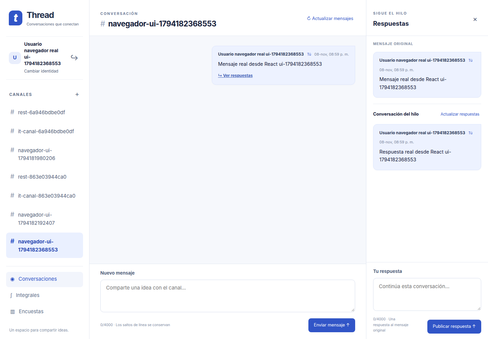

# Tarea 6 — E2E real de Chat y Threads con corrección local de prueba

## Resultado y alcance

**E2E completo aprobado con servicios reales y copias docentes corregidas solo
para pruebas locales.** React → `/graphql` → Gateway → APIs → MongoDB/RabbitMQ.
No se usaron mocks, interceptores de respuestas ni recuperación administrativa
de IDs en el modo corregido. No se modificaron Gateway, frontend, Thread Service,
contrato GraphQL v1, Kubernetes ni los módulos de Integrales/Polls.

El PR [#7](https://github.com/IsaiasACF/Thread-Service/pull/7) se fusionó con la
autorización expresa del usuario después de verificar destino main, ausencia de
conflictos y checks aprobados. SHA:
`002f4f9b594e897d5343bae17162df51217707a4` (2026-11-08 UTC).
Esta etapa parte de ese merge en `feature/tarea6-chat-e2e-final`.
Su nuevo PR se deja abierto: **no se autoriza ni realiza su merge**.

La evidencia del fallo original del PR #7 se conserva íntegra en
[evidencia_chat_integration](evidencia_chat_integration). Sus resultados describen
la fuente original; este documento describe además una variante local corregida.
**No se corrigió el repositorio docente ni sus despliegues compartidos.**

## Causa y parche mínimo

En el commit docente fijado
`d15f2e20ced1007099b90bf59b720e97be3d2d4a`, PyMongo agrega `_id: ObjectId` al
mismo diccionario pasado a `insert_one()`. Users/Channels intentan devolverlo como
JSON; Messages intenta publicarlo con `json.dumps()`. Las tres creaciones guardan
el registro pero responden HTTP 500. Nuestro Gateway conserva ese error.

[apply_test_patch.py](../../integration/chat/apply_test_patch.py) no edita la
fuente original. Genera otra carpeta privada, fuera del repositorio, que contiene
solo los nueve archivos fijados por `source.lock.json` y un manifiesto de prueba.
Las únicas tres diferencias de código son:

```diff
- users.insert_one(user)
+ users.insert_one(user.copy())
- channels.insert_one(channel)
+ channels.insert_one(channel.copy())
- messages.insert_one(message)
+ messages.insert_one(message.copy())
```

Se verifican todos los hashes originales antes de crear la copia. La verificación
de la copia revierte en memoria esas tres sustituciones y exige los hashes
originales, ningún archivo adicional y el manifiesto exacto. Rechaza fuentes
inesperadas, enlaces simbólicos, destinos dentro del repositorio o superpuestos,
y copias alteradas. Una segunda ejecución válida no reescribe los archivos; una
copia alterada se rechaza, nunca se repara silenciosamente. La creación es mediante
directorio temporal privado y renombrado. No se versiona código docente completo.

Los modos `original` y `corrected` usan carpetas y estados distintos. El lanzador
rechaza reanudar un estado perteneciente al otro modo. `prepare.py` genera un
`compose.env` privado con `CHAT_SOURCE_MODE` y `CHAT_BASE_SOURCE`; `verify_compose.py`
verifica que etiquetas, contextos y hashes correspondan al modo declarado.

## Arquitectura y versiones ejecutadas

Se reutilizó el lanzador del PR #7, con listeners exclusivamente en loopback:

```text
Chromium → Vite :15173 → /graphql → Gateway :15000
                                     ├─ Users :18001 ───── chat_users
                                     ├─ Channels :18002 ── chat_channels
                                     ├─ Messages :18003 ── chat_messages + RabbitMQ
                                     └─ Threads :18004 ─── chat_integration_threads
                                                          └─ worker → RabbitMQ
MongoDB :27027; RabbitMQ AMQP :15679; EPMD :14379; distribución :25679
```

Una instancia MongoDB dedicada conserva cuatro bases separadas en disco. No se
usan bases, volúmenes o procesos de terceros. Estado, fuentes, credenciales y
logs permanecen fuera del repositorio. No se realizaron operaciones Kubernetes.

| Componente | Versión realmente utilizada |
|---|---|
| MongoDB | 7.0.14, binario oficial verificado por SHA-256 |
| RabbitMQ / Erlang | 3.12.1 / OTP 25.3.2.8, paquetes extraídos sin instalación global |
| Users/Channels/Messages | Commit fijado arriba; tres copias `insert_one` en modo corregido |
| Dependencias docentes | FastAPI 0.115.12, PyMongo 4.12.1, Uvicorn 0.34.2, Pika 1.3.2 |
| Gateway | FastAPI 0.115.12, Ariadne 0.26.2, httpx 0.28.1 |
| Thread Service | Código original de main; FastAPI 0.162.2, PyMongo 4.19.0, Pika 1.4.4 |
| Node | 22.23.4 |

Los runtimes se reutilizaron del PR #7; sus versiones y hashes están en
[versions.json](evidencia_chat_integration/versions.json). Los hashes originales y
corregidos de esta ejecución constan en
[patch-manifest.json](evidencia_chat_e2e_final/patch-manifest.json).

## Preparación reproducible

Desde la raíz, Python 3.12. Para instalar los venvs, MongoDB, RabbitMQ/Erlang,
Node y Playwright sin Docker, seguir la sección **Fallback reproducible sin
Docker** de [CHAT_INTEGRATION.md](CHAT_INTEGRATION.md). Mantener las variables
`CHAT_IT_PARENT` y las rutas de runtimes de esa guía. Preparar fuentes nuevas:

```sh
export CHAT_IT_PARENT="$(mktemp -d /tmp/thread-chat-e2e.XXXXXX)"
python3 integration/chat/prepare.py --directory "$CHAT_IT_PARENT/assets" --mode corrected
export CHAT_IT_ORIGINAL="$CHAT_IT_PARENT/assets/source/microservicios-d15f2e20ced1007099b90bf59b720e97be3d2d4a/03_Comunicación/demo"
export CHAT_IT_SOURCE="$CHAT_IT_PARENT/assets/corrected-source"
python3 integration/chat/prepare.py --verify-source "$CHAT_IT_ORIGINAL"
# Repetir el parche es seguro y no reescribe una copia válida:
python3 integration/chat/apply_test_patch.py --source "$CHAT_IT_ORIGINAL" --destination "$CHAT_IT_SOURCE"
```

Usar los requirements originales para el venv docente; el parche no cambia
ninguna dependencia. El árbol original descargado sigue disponible para
reproducir el fallo. No imprimir ni versionar `compose.env`, credenciales o logs.

### Procesos locales reales (ruta ejecutada)

Tras preparar los runtimes conforme a la guía anterior:

```sh
"$CHAT_IT_PARENT/thread-python/bin/python" integration/chat/process_stack.py \
  --mode corrected --source "$CHAT_IT_SOURCE" \
  --mongod "$CHAT_IT_PARENT/runtime/mongo/mongodb-linux-x86_64-ubuntu2204-7.0.14/bin/mongod" \
  --rabbit-runtime "$CHAT_IT_PARENT/runtime/rabbit" \
  --base-python "$CHAT_IT_PARENT/base-python/bin/python" \
  --thread-python "$CHAT_IT_PARENT/thread-python/bin/python" \
  --gateway-python "$CHAT_IT_PARENT/gateway-python/bin/python" \
  --node "$(command -v node)" --state "$CHAT_IT_PARENT/state-corrected"
```

Esperar `STACK_READY`. En otra terminal, conservando las mismas variables:

```sh
"$CHAT_IT_PARENT/thread-python/bin/python" integration/chat/probe.py \
  --mode corrected --manifest "$CHAT_IT_PARENT/state-corrected/manifest.json" \
  --output "$CHAT_IT_PARENT/state-corrected/graphql-report.json" \
  --allow-local-writes --faults-and-restart
```

El resultado correcto es código **0**, nueve operaciones exitosas y ningún
bloqueo. `--diagnose-upstream` está prohibido en modo corregido. Los IDs provienen
exclusivamente de respuestas reales REST/GraphQL; no se instancia MongoClient
en esa rama del probe. Los pings internos del lanzador solo verifican salud.

Para el navegador real, instalar Playwright como en la guía del PR #7:

```sh
export PLAYWRIGHT_BROWSERS_PATH="$CHAT_IT_PARENT/browser-cache"
node integration/chat/browser_check.cjs \
  "$CHAT_IT_PARENT/state-corrected/manifest.json" - \
  "$CHAT_IT_PARENT/state-corrected/browser-report.json" \
  "$CHAT_IT_PARENT/state-corrected/screenshots" \
  "$CHAT_IT_PARENT/browser/node_modules/playwright" corrected \
  "$CHAT_IT_PARENT/thread-python/bin/python"
```

El argumento `-` exige que no se entregue un fixture de IDs. El navegador arranca
un observador AMQP real antes de escribir; obtiene IDs de las respuestas de las
mutaciones y los compara con la interfaz y las consultas posteriores. Sale **0**
solo si completa también el reinicio de los diez procesos y las lecturas finales.
No usa `page.route()`, respuestas simuladas ni inyección de localStorage.

Ctrl+C en la terminal del lanzador detiene exclusivamente sus procesos y conserva
los datos. Para reabrirlos, repetir su comando con `--resume`, mismo modo, fuente
y estado. No borrar bases ni directorios, y no iniciar dos modos simultáneamente
sobre los mismos puertos. El controlador confirma cada arranque solo tras salud.

### Reproducir el defecto original

Detener primero el stack corregido. Repetir el comando del lanzador con
`--mode original --source "$CHAT_IT_ORIGINAL" --state "$CHAT_IT_PARENT/state-original"`.
Luego:

```sh
"$CHAT_IT_PARENT/thread-python/bin/python" integration/chat/probe.py \
  --mode original --manifest "$CHAT_IT_PARENT/state-original/manifest.json" \
  --output "$CHAT_IT_PARENT/state-original/graphql-report.json" \
  --allow-local-writes --diagnose-upstream --faults-and-restart
node integration/chat/browser_check.cjs \
  "$CHAT_IT_PARENT/state-original/manifest.json" \
  "$CHAT_IT_PARENT/state-original/graphql-report.json" \
  "$CHAT_IT_PARENT/state-original/browser-report.json" \
  "$CHAT_IT_PARENT/state-original/screenshots" \
  "$CHAT_IT_PARENT/browser/node_modules/playwright" original
```

**Ambos comandos salen 1 deliberadamente**: seis operaciones exitosas y tres
creaciones HTTP 500. El diagnóstico original sí permite recuperar el ID de su
propio usuario persistido mediante lectura administrativa, lo declara en el
informe y nunca lo presenta como E2E exitoso. React conserva borradores y comunica
resultado incierto, con exactamente un POST de cada creación. Un fallo inesperado
del navegador sale 2. Esa ruta se volvió a ejecutar y quedó documentada en
[original-graphql.json](evidencia_chat_e2e_final/original-graphql.json) y
[original-browser.json](evidencia_chat_e2e_final/original-browser.json).

### Docker Compose

El CLI está instalado, pero `docker info` sigue indicando ausencia de daemon.
**No se ejecutaron contenedores ni se comprobó DNS interno Docker.** Ambos modos
pasaron `verify_compose.py`, incluidos siete contextos existentes, sus hashes,
etiquetas, red exacta `microsvcs` y puertos publicados en loopback.

Cuando Docker Engine esté disponible, usar el `compose.env` preparado arriba:

```sh
python3 integration/chat/verify_compose.py --env-file "$CHAT_IT_PARENT/assets/compose.env"
docker network inspect microsvcs >/dev/null 2>&1 || docker network create microsvcs
dc() { docker compose --env-file "$CHAT_IT_PARENT/assets/compose.env" -f integration/chat/compose.yaml "$@"; }
dc config --quiet
dc up --build -d --wait
# Comprobar acceso desde el Gateway, usando puertos internos 8000:
dc exec chat-gateway python -c 'import os,urllib.request; [print(n,urllib.request.urlopen(os.environ[n+"_BASE_URL"]+"/health",timeout=3).status) for n in ["USERS","CHANNELS","MESSAGES","THREADS"]]'
# Conservar volúmenes y datos al detener:
dc down
```

No usar `down -v`, prune ni eliminar la red compartida. El proyecto es único y
sus aliases `chat-it-*` se limitan a su red privada. El modo original usa otro
`prepare.py --directory ... --mode original` y otro proyecto. El probe/controlador
de procesos es específico del fallback; no se debe apuntar a contenedores ajenos.

## Nueve operaciones y resultados reales

| Operación GraphQL | Modo corregido | Verificación |
|---|---|---|
| createUser | Éxito confirmado | ID de API, nombre, posterior user(id) |
| user | Éxito | Misma identidad |
| createChannel | Éxito confirmado | ID de API, nombre, inclusión en listado |
| channels | Éxito | Contiene el canal creado |
| channel | Éxito | Mismo ID/nombre |
| sendMessage | Éxito confirmado | Autor, canal, contenido y fecha UTC |
| messages | Éxito | Recupera el mismo mensaje |
| replies | Éxito | Thread vacío y posterior respuesta persistida |
| createReply | Éxito confirmado | Autor, canal, mensaje raíz y fecha UTC |

El probe comprueba además POST REST de Users, Channels y Messages: **201**,
JSON serializable sin `_id`, IDs no vacíos y lectura posterior. No confunde ese
HTTP 201 del upstream con el HTTP 200 de la envoltura GraphQL. Evidencia:
[corrected-graphql.json](evidencia_chat_e2e_final/corrected-graphql.json).

Documentos ejecutados y variables están en `QUERIES` de `probe.py` y en el
informe; los ejemplos manuales completos se conservan en
[CHAT_GATEWAY.md](CHAT_GATEWAY.md). Recorrido mínimo con IDs devueltos por APIs:

```graphql
mutation { createUser(displayName: "Prueba local") { id displayName } }
mutation { createChannel(name: "prueba-local") { id name } }
mutation($c: ID!, $u: ID!) {
  sendMessage(channelId: $c, authorId: $u, content: "Mensaje real") {
    id channelId authorId content createdAt
  }
}
mutation($c: ID!, $m: ID!, $u: ID!) {
  createReply(channelId: $c, messageId: $m, authorId: $u, content: "Respuesta real") {
    id channelId messageId authorId content createdAt
  }
}
query($c: ID!, $m: ID!, $u: ID!) {
  user(id: $u) { id displayName }
  channels { id name }
  channel(id: $c) { id name }
  messages(channelId: $c) { id channelId authorId content createdAt }
  replies(channelId: $c, messageId: $m) { id channelId messageId authorId content createdAt }
}
```

## Recorrido React y persistencia observados

1. Abrir sin identidad, crear usuario y recibir confirmación real. ID de la
   respuesta coincide con localStorage. Cerrar identidad, recuperarla por ese ID
   y recargar: se revalida con GraphQL.
2. Crear canal desde React, abrirlo y comprobar ID/ruta/listado.
3. Enviar mensaje, confirmar éxito y limpieza del borrador, mostrar contenido,
   autor y fecha. Actualizar y comprobar una sola instancia del mensaje.
4. Abrir Threads, publicar respuesta, confirmar éxito y lectura del mismo ID
   asociado al canal/mensaje raíz. No se publica como mensaje normal.
5. Recargar: identidad revalidada, mensaje y respuesta recuperados del backend.
6. Detener nuestro Users: localStorage se conserva, escritura se deshabilita y
   conversación sigue legible; arrancar y revalidar recupera la interfaz.
7. Detener en orden inverso y arrancar **MongoDB, EPMD, RabbitMQ, Users, Channels,
   Messages, Threads, worker, Gateway y Vite** conservando sus directorios de
   datos. El informe compara los diez PIDs anteriores y posteriores.
8. Abrir nuevamente el canal en el mismo contexto de navegador: identidad válida,
   mensaje y respuesta recuperados. GraphQL devuelve los mismos cuatro IDs.

Network registra únicamente peticiones de datos al mismo origen `/graphql`,
**un POST por cada una de las cuatro mutaciones**, cero errores de consola y
cero errores de página. Esto no prohíbe los assets/HMR propios de Vite.
[corrected-browser.json](evidencia_chat_e2e_final/corrected-browser.json) conserva
las relaciones, lecturas antes/después, eventos y conteos reales.

La persistencia MongoDB se prueba por lecturas de las APIs después de reiniciar
el proceso MongoDB con el mismo directorio, además del reinicio completo. No se
recupera ningún ID mediante MongoDB en modo corregido. No se usa caché del cliente
como prueba única: también se consultan las APIs tras el reinicio.



Otras capturas reales: [identidad creada](evidencia_chat_e2e_final/01-identidad-creada.png),
[creaciones confirmadas](evidencia_chat_e2e_final/02-chat-y-respuesta-confirmados.png),
[recarga](evidencia_chat_e2e_final/03-recarga-y-respuesta-real.png) y
[Users detenido](evidencia_chat_e2e_final/04-users-no-disponible-real.png).

## RabbitMQ y errores reales

`events.py` observa el broker real mediante una cola exclusiva temporal,
vinculada únicamente a los routing keys existentes `chat.message.created` y
`chat.thread.reply.created`. Se verifican cuerpos JSON, IDs, canal, autor y
mensaje raíz; el worker de Threads publica su outbox original. Los eventos
correspondientes al mensaje y respuesta creados desde React se reciben antes
del reinicio y se conservan en el informe del navegador. No se cambia exchange,
broker, contratos, servicios ni sus políticas de publicación.

**No se afirma durabilidad del evento docente tras reiniciar RabbitMQ.** Su
exchange es no durable y Messages no configura entrega persistente. La evidencia
acredita entrega real al consumidor antes del reinicio y persistencia de los
registros MongoDB después. No se inventan eventos de Users/Channels.

Se comprobaron usuario/canal/raíz inexistentes, autor inválido, contenido vacío,
conexión rechazada, timeout real con SIGSTOP/SIGCONT de nuestro Users y dependencia
503 deteniendo nuestro Messages. El modo original conserva la prueba del
resultado incierto tras escritura y de ausencia de reintentos automáticos.
Todas las interrupciones afectaron únicamente procesos privados de prueba.

## Regresión y reproducción de pruebas

| Suite | Aprobadas | Fallidas | Omitidas |
|---|---:|---:|---:|
| React, Vitest/Testing Library | 48 | 0 | 0 |
| Gateway, incluido snapshot GraphQL v1 | 263 | 0 | 0 |
| Thread Service con MongoDB/RabbitMQ propios | 107 | 0 | 0 |
| Kubernetes offline | 20 | 0 | 0 |
| Lanzador y parche privado | 23 | 0 | 0 |
| **Total de regresión** | **461** | **0** | **0** |

`npm ci`, TypeScript/Vite, validación estática Kubernetes, Compose principal y
los dos modos Compose de Chat y `git diff --check` correctos. Las pruebas del
parche incluyen tres cambios exactos, originales intactos, idempotencia, destinos
ajenos, fuentes inesperadas, alteraciones/symlinks y rechazo de éxito ficticio o
recuperación administrativa en modo corregido. CI prepara las fuentes fijadas
antes de ejecutar esos tests; sus checks de configuración **no ejecutan el E2E**.

```sh
export CHAT_TEST_ORIGINAL_SOURCE="$CHAT_IT_ORIGINAL"
"$CHAT_IT_PARENT/thread-python/bin/python" -m pytest integration/chat/test_launcher.py integration/chat/test_patch.py -q -W error
"$CHAT_IT_PARENT/gateway-python/bin/python" -m pytest -c gateway/pytest.ini gateway/tests -q -W error
"$CHAT_IT_PARENT/thread-python/bin/python" -m pytest scripts/test_k8s_rendering.py -q -W error
"$CHAT_IT_PARENT/thread-python/bin/python" scripts/validate_k8s.py
(cd frontend && npm ci && npm test && npm run build)
git diff --check
```

Para las 107 pruebas originales, usar el bloque de ejecución de
[CHAT_INTEGRATION.md](CHAT_INTEGRATION.md), sustituyendo su estado por
`state-corrected`: lee las credenciales privadas solo en memoria y pasa las URLs
por entorno. Sin MongoDB/RabbitMQ se omiten seis pruebas, pero **en esta ejecución
no se omitió ninguna**. Las pruebas unitarias existentes conservan sus mocks;
los informes de integración real no los usan.

Los comandos originales de diagnóstico salen 1 como resultado esperado del
defecto externo; se informan separadamente, no como regresiones fallidas ni como
E2E aprobado. Se corrigió un selector del botón del script de navegador durante
su ampliación; no fue necesario modificar la aplicación.

## Límites y próximos pasos

- Éxito local condicionado a las tres copias docentes corregidas. Coordinar la
  solución oficial antes de usar fuentes o despliegues compartidos originales.
- Docker Compose validado estáticamente; falta ejecución y prueba de DNS interno.
  El fallback real no demuestra networking de contenedores.
- Kubernetes pendiente: no se desplegó ni modificó ningún recurso, Secret o
  manifiesto; comprobar imágenes/configuración/contratos antes del despliegue.
- No se añadieron funcionalidades, ni se tocaron las carpetas de Andrés, el
  Compose compartido o `integration/overrides`. Integrales/Polls continúan
  independientes; su integración puede usar su propio override y red microsvcs.
- No versionar fuentes completas, estado MongoDB/RabbitMQ, credenciales o logs.
  Los procesos propios de esta sesión se detuvieron al finalizar, conservando
  los datos fuera del repositorio. Para reproducir, detener únicamente los
  procesos propios y conservar sus datos para reanudar.
