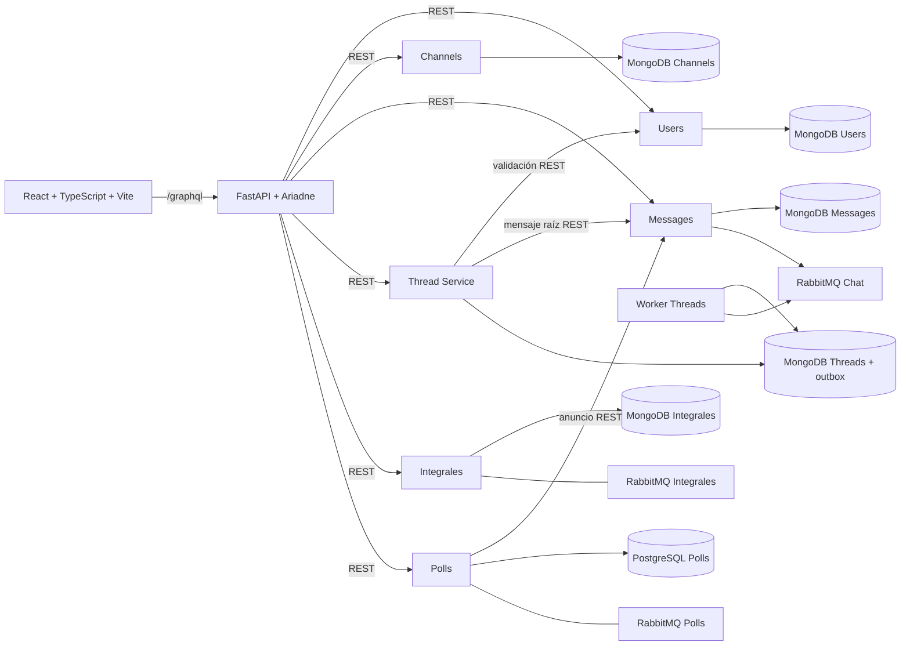
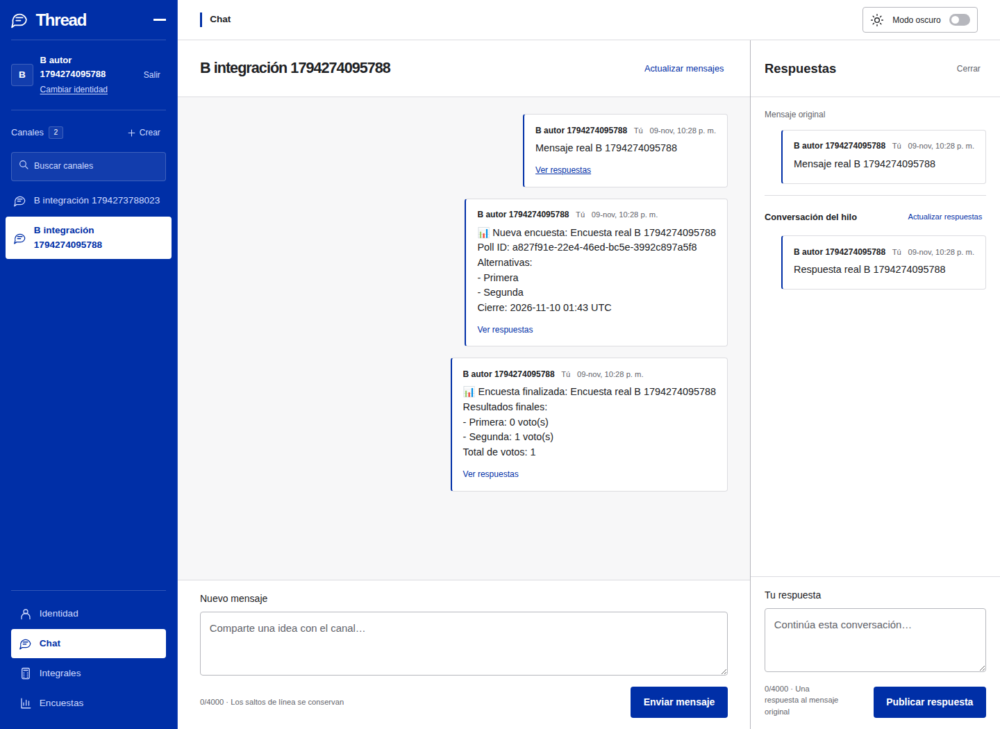

# Tarea 6 — Entrega integrada

## Resultado y estado académico

La interfaz de Chat, Threads, Integrales y Polls funciona en un mismo entorno
Docker real. Se ejecutaron lecturas, escrituras, restricciones, recuperación y
navegación sin mocks ni interceptores. El navegador utiliza exclusivamente
`/graphql` para datos. El contrato GraphQL v1 sigue intacto.

**La entrega académica aún requiere adjuntar/publicar el video de demostración y
su enlace.** Hay guion y grabaciones reales locales verificadas, sin narración;
no se presentan como video público entregado. Kubernetes no es requisito de la
[sección Tarea de la Unidad 6](https://github.com/rmasad/microservicios/blob/main/06_Interfaz/README.md).
No se desplegó ni modificó ningún recurso del clúster.

Base: main `fd3bb278c1e840406432e85c55e379ebec185c74`, con PR #4 a #9 verificados
como fusionados. Rama de esta integración: `feature/tarea6-integracion-final`.
Se deja su nuevo PR abierto para revisión, **sin merge**.
El entorno corregido de esta ejecución queda levantado en http://127.0.0.1:15173
con servicios restaurados; la variante original se detuvo conservando volúmenes.

## Arquitectura



Los brokers de B respetan su configuración externa. El broker de Integrales no
recibe eventos de Messages; **el bot opcional no está integrado ni se declara
funcionalidad entregada**. No se modificaron contratos de eventos ni servicios
externos para conseguir resultados positivos.

| Componente | Responsable / repositorio público |
|---|---|
| Frontend y Gateway | A/B, [Thread-Service](https://github.com/IsaiasACF/Thread-Service) |
| Thread Service y worker | A, mismo repositorio |
| Users, Channels, Messages | Docente, [rmasad/microservicios](https://github.com/rmasad/microservicios), demo de Comunicación |
| Integrales | Equipo externo, [Misulas/modulo-integrales](https://github.com/Misulas/modulo-integrales); integración de B |
| Polls | Equipo externo, [TomasCano-Usm/INF326-Microservicio-Polls](https://github.com/TomasCano-Usm/INF326-Microservicio-Polls); integración de B |

Se confirmó públicamente la visibilidad de los cuatro repositorios con la API
GitHub sin autenticación; [evidencia](evidencia_integracion_final/public-repositories.json).
El [contrato compartido](CONTRATO_COMPARTIDO.md) conserva tipos, argumentos y
nullabilidad; su snapshot independiente sigue pasando las pruebas.

## Funcionalidades

- Identidad local: crear usuario, validar/recuperar por ID, recordar, cambiar y
  cerrar. No es autenticación con contraseñas.
- Canales: creación, listado, búsqueda local y selección.
- Chat: publicación/lectura/actualización, autores, fechas, borradores ante
  resultados inciertos; polling activo y mutaciones sin retry automático.
- Threads: mensaje raíz, respuestas, apertura/cierre, autores y fechas; worker
  y outbox originales. Sin respuestas anidadas, edición ni eliminación.
- Integrales: cálculo definido/indefinido, resultado simbólico en LaTeX escapado,
  resultado numérico cuando corresponde, estado de dominio fallido, historial,
  filtros, paginación y detalle. No se añade composición tipográfica nueva.
- Polls: creación idempotente, anuncio en el mismo Messages del chat, consulta,
  opciones, voto, resultados, cierre del autor, rechazos por duplicado/autor ajeno/
  encuesta cerrada, estado pendiente y recuperación automática del anuncio.
- Interfaz común: navegación persistente, claro/oscuro/sistema, tema guardado,
  responsive, menú móvil, búsqueda, portapapeles, teclado y estados de carga/error.

## Requisitos y fuentes verificadas

Docker Engine y Compose v2 operativos, Python 3.12 y acceso de descarga a GitHub
más los registros públicos de imágenes. Node 22 se requiere para desarrollar o
probar fuera de Docker; las imágenes lo incluyen. Para QA: Playwright y Chromium.
No requiere Docker Desktop específicamente, sudo, Kubernetes ni bases ajenas.

La preparación reutiliza `integration/chat/prepare.py` y `apply_test_patch.py`.
El add-on `integration/final/compose.yaml` extiende el Compose de Chat y los
servicios existentes de `integration/overrides/polls-integrals.yaml`: **no crea
otra implementación de los microservicios ni otra pareja Gateway/frontend**.

| Fuente externa | Revisión fijada |
|---|---|
| Chat docente | `d15f2e20ced1007099b90bf59b720e97be3d2d4a` |
| Integrales | `4a03648fb93e80a5b74185cbc9672f0f17087964` |
| Polls | `d9b0627a65371da72107e15225f4af6fcd55eb1f` |

Las fuentes se descargan fuera del repositorio. Chat verifica sus nueve archivos
fijados; B verifica SHA-256 del archivo descargado **antes de extraerlo** y de
cada uno de sus 136 archivos de build. El orquestador vuelve a verificar antes
de operar. MongoDB, PostgreSQL y los brokers se fijan además por digest en el
add-on final. No se depende de carpetas personales de la sesión anterior de B.
Los requirements externos originales no se reescriben; las versiones realmente
resueltas e imágenes utilizadas se conservan en la evidencia de esta ejecución.

### Advertencia obligatoria sobre el chat docente

El docente usa `insert_one(diccionario)` y después devuelve/publica ese mismo
diccionario. PyMongo agrega `_id: ObjectId`; las tres creaciones persisten pero
responden HTTP 500. **La fuente original y sus despliegues no se corrigieron.**

Para el E2E normal se usa `--mode corrected`: copias privadas con exactamente
`users.insert_one(user.copy())`, `channels.insert_one(channel.copy())` y
`messages.insert_one(message.copy())`. No hay otros cambios de código externo.
El parche es idempotente, verifica hashes inversos y rechaza alteraciones.

`--mode original` conserva el defecto. Las dos variantes usan árboles, estados y
proyectos diferentes. No mezclar sus fuentes ni reutilizar sus directorios. El
E2E exitoso está condicionado a esas copias corregidas solo para integración
local. [Explicación completa](CHAT_E2E_FINAL.md).

## Arranque reproducible desde cero

Desde un checkout público de esta rama/PR:

```sh
git clone https://github.com/IsaiasACF/Thread-Service.git
cd Thread-Service
git switch feature/tarea6-integracion-final
docker version
docker compose version
export TAREA6_FINAL_ROOT="$(mktemp -d /tmp/tarea6-final.XXXXXX)"
export FINAL_STACK_DIR="$TAREA6_FINAL_ROOT/stack"
python3 integration/final/prepare.py --directory "$FINAL_STACK_DIR" --mode corrected
python3 integration/final/run.py --directory "$FINAL_STACK_DIR" config
python3 integration/final/run.py --directory "$FINAL_STACK_DIR" up
```

`prepare.py` necesita un directorio nuevo y genera credenciales aleatorias en un
`compose.env` privado. No imprimirlo, copiarlo al repositorio ni publicar la
configuración expandida. Para reanudar, **conservar el mismo directorio/env** y
repetir `run.py up`; no volver a preparar fuentes sobre ese directorio.

Si el daemon usa otro endpoint local, seleccionar `DOCKER_HOST` según la
instalación. La herramienta lo respeta y no cambia el contexto global. Si falta
buildx pero el motor admite construcción clásica, se comprobó esta alternativa:

```sh
DOCKER_BUILDKIT=0 COMPOSE_BAKE=false python3 integration/final/run.py --directory "$FINAL_STACK_DIR" up
```

La herramienta crea la red externa exacta **`microsvcs` solo si no existe**.
No cambia su propiedad ni la elimina. Los aliases `chat-it-*` se limitan a la red
privada del proyecto para evitar que otro stack conectado a microsvcs resuelva
sus APIs por accidente. El proyecto y sus volúmenes reciben un nombre único.
No se utilizan nombres de contenedor fijos de la sesión anterior.

| Acceso local | Dirección |
|---|---|
| Frontend | http://127.0.0.1:15173 |
| Gateway salud | http://127.0.0.1:15000/health |
| GraphQL | POST http://127.0.0.1:15000/graphql |
| REST Chat/Threads, diagnóstico local | 127.0.0.1:18001–18004 |
| MongoDB/PostgreSQL/RabbitMQ | Sin puertos publicados al host |

Puertos internos: Users/Channels/Messages/Threads/Integrales **8000**, Polls
**8004**, Gateway **5000**, Vite **5173**. No confundirlos con puertos del host.

### Variables

El env privado contiene `CHAT_BASE_SOURCE`, `CHAT_SOURCE_MODE`, `CHAT_PROJECT_NAME`,
`INTEGRALS_SOURCE_DIR`, `POLLS_SOURCE_DIR`, contraseñas aleatorias para cada broker
y PostgreSQL. Los `CHAT_*_PORT` permiten puertos alternativos en loopback. El modo
original prepara por defecto 28001–28004, Gateway 25000 y frontend 25173.

El Compose fija `USERS_BASE_URL`, `CHANNELS_BASE_URL`, `MESSAGES_BASE_URL`,
`THREADS_BASE_URL`, `INTEGRALS_BASE_URL` y `POLLS_BASE_URL` por DNS privado. Polls y
Threads utilizan **el mismo Messages que Gateway**, e Integrales/Threads el mismo
Users. Polls no configura clientes Users/Channels propios: el anuncio pasa por
Messages y su validación existente. Vite recibe solo `GATEWAY_PROXY_TARGET`.
El navegador no recibe URLs REST ni credenciales de almacenamiento/mensajería.

Se verificó la salud de los seis servicios **desde el contenedor Gateway**, no
solo desde el host: [gateway-connectivity.json](evidencia_integracion_final/gateway-connectivity.json).

### Parada, reanudación y protección de datos

```sh
python3 integration/final/run.py --directory "$FINAL_STACK_DIR" ps
python3 integration/final/run.py --directory "$FINAL_STACK_DIR" down
# Los volúmenes y el env privado se conservan; reanudar después:
python3 integration/final/run.py --directory "$FINAL_STACK_DIR" up
```

Nunca usar `down -v`, `volume prune`, `system prune` ni borrar directorios de datos.
Los controles de fallos requieren servicios explícitos y resuelven IDs únicamente
dentro del proyecto ligado al marcador privado. No se aceptan nombres ajenos.
`run.py snapshot` selecciona solo metadatos seguros; no imprime Env ni secretos.

## Reproducir QA real

Preparar herramientas fuera del repositorio, sin instalaciones globales:

```sh
python3 -m venv "$TAREA6_FINAL_ROOT/tests"
"$TAREA6_FINAL_ROOT/tests/bin/pip" install -r requirements-dev.txt
npm install --prefix "$TAREA6_FINAL_ROOT/browser" playwright@1.65.0
export PLAYWRIGHT_BROWSERS_PATH="$TAREA6_FINAL_ROOT/browser-cache"
node "$TAREA6_FINAL_ROOT/browser/node_modules/playwright/cli.js" install chromium ffmpeg
export TAREA6_CHROMIUM="$(node -e 'console.log(require(process.argv[1]).chromium.executablePath())' "$TAREA6_FINAL_ROOT/browser/node_modules/playwright")"
export TAREA6_EVIDENCE="$TAREA6_FINAL_ROOT/evidence"
export B_E2E_ORIGIN=http://127.0.0.1:15173
export E2E_VIDEO_DIR="$TAREA6_FINAL_ROOT/videos"
node integration/overrides/browser-e2e.cjs \
  "$TAREA6_FINAL_ROOT/browser/node_modules/playwright" "$TAREA6_EVIDENCE" "$TAREA6_CHROMIUM"
node integration/overrides/recovery-e2e.cjs \
  "$TAREA6_FINAL_ROOT/browser/node_modules/playwright" "$TAREA6_EVIDENCE/browser-report.json" "$TAREA6_EVIDENCE" "$TAREA6_CHROMIUM"
node integration/overrides/ui-theme-check.cjs \
  "$TAREA6_FINAL_ROOT/browser/node_modules/playwright" "$TAREA6_EVIDENCE/browser-report.json" "$TAREA6_FINAL_ROOT/ui" "$TAREA6_CHROMIUM"
node integration/overrides/persistence-e2e.cjs "$TAREA6_EVIDENCE/browser-report.json" "$TAREA6_EVIDENCE"
```

Para evitar depender de nombres internos de instalación, también puede omitirse
el último argumento del E2E principal: Playwright utilizará su Chromium instalado.
El script visual recibe una ruta real. No ejecutar los scripts de caídas contra
servicios compartidos: `FINAL_STACK_DIR` debe apuntar al proyecto propio recién
preparado. El modo anterior de los scripts de B se conserva para su entorno
histórico, pero **la reproducción recomendada es la unificada**.

El E2E crea dos usuarios, canal, mensaje, respuesta, integral calculada y fallida,
encuesta/voto/cierre. Prepara solo los registros reales adicionales necesarios
para probar la segunda página del historial. No usa respuestas interceptadas ni
IDs administrativos. Las consultas negativas a GraphQL verifican el rechazo del
servidor aunque la UI ya deshabilite esas acciones. Los POST de preparación de
historial y las repeticiones deliberadas de idempotencia no son retries.

Los scripts de recuperación paran solo Messages/Polls/Integrales propios y
pausan Threads para un timeout real. Restauran servicios al finalizar. Reiniciar
las seis bases conserva sus volúmenes; se comparan `StartedAt`, IDs y datos antes
y después mediante GraphQL. Estas pruebas escriben datos sintéticos locales.

### Variante docente original

```sh
export TAREA6_ORIGINAL_STACK="$TAREA6_FINAL_ROOT/original-stack"
python3 integration/final/prepare.py --directory "$TAREA6_ORIGINAL_STACK" --mode original
python3 integration/final/run.py --directory "$TAREA6_ORIGINAL_STACK" up chat-gateway chat-users chat-channels chat-messages
"$TAREA6_FINAL_ROOT/tests/bin/python" integration/final/original_probe.py \
  --directory "$TAREA6_ORIGINAL_STACK" --output "$TAREA6_FINAL_ROOT/original-report.json" --diagnose-original
# El comando anterior SALE 1: confirma el defecto, NO un E2E aprobado.
python3 integration/final/run.py --directory "$TAREA6_ORIGINAL_STACK" down
```

Ese diagnóstico **sí** permite una lectura administrativa del usuario recién
persistido en SU MongoDB, lo declara expresamente y se prohíbe en modo corregido.
Luego recupera canal/mensaje mediante APIs. Se verifican los tres errores 500 y
un POST por creación; no se cambió el Gateway para ocultarlos.

## Resultados y evidencias

| Comprobación | Resultado real |
|---|---|
| E2E React conjunto | Aprobado; 110 peticiones de datos solo /graphql; consola/página sin errores |
| Mutaciones de UI | CreateUser 2; CreateChannel/SendMessage/CreateReply/CreatePoll/VotePoll/ClosePoll 1 cada una; CalculateIntegral 2 |
| Integrales | 1/3 con numérico correcto; indefinida con + C; failed/NOT_AN_INTEGRAL; historial/filtro/página 2/detalle/recarga |
| Polls | Anuncio único en Messages; voto/resultados; CONFLICT duplicado/cerrado; FORBIDDEN cierre ajeno |
| Idempotencia y recuperación | Mismo cuerpo/clave → mismo ID; cuerpo distinto → CONFLICT; pendiente → abierta al volver Messages |
| Aislamiento | Polls caído no bloquea Chat/Threads/Integrales; Integrales caído no bloquea Threads |
| Timeout de escritura | UPSTREAM_TIMEOUT real, borrador conservado, un POST; respuesta persistida recuperada posteriormente por API |
| Interfaz común | 13 capturas claro/oscuro/escritorio/móvil; búsqueda, copia real, tema/sistema, teclado/Escape/foco, sin overflow |
| Persistencia | Ver informe persistence-report; mismos registros tras reinicio de 6 bases y 9 aplicaciones |
| Fuente original | Tres HTTP 500 reproducidos realmente en Docker; datos persistidos; resultado normal permanece fallido |
| Contratos y externos | SDL/snapshot intactos; fuentes originales y repositorios ajenos sin modificar |

[Evidencia nueva](evidencia_integracion_final): informes de navegador,
recuperación/persistencia, UI, conectividad DNS interna, versiones, fuentes,
metadatos de contenedores, hashes y capturas. Se conserva el informe que detectó
el favicon 404 y las evidencias históricas de A/B sin sobrescribirlas.



Las grabaciones locales son interacciones reales de Chromium, no capturas
convertidas en video. Se decodificaron con ffmpeg y verificaron duración/hash.
[Metadatos](evidencia_integracion_final/video-validation.json). No se subieron
videos al repositorio ni a almacenamiento externo. Para el video docente final,
seguir [GUIÓN_VIDEO.md](GUIÓN_VIDEO.md) y añadir narración/enlace público.

### Suites automatizadas

| Suite | Aprobadas | Fallidas | Omitidas |
|---|---:|---:|---:|
| Frontend | 63 | 0 | 0 |
| Gateway y snapshot | 323 | 0 | 0 |
| Thread Service con MongoDB/RabbitMQ reales | 107 | 0 | 0 |
| Kubernetes offline | 20 | 0 | 0 |
| Herramientas Chat/Threads | 23 | 0 | 0 |
| Protecciones nuevas de integración | 14 | 0 | 0 |
| **Total** | **550** | **0** | **0** |

`npm ci`, TypeScript/Vite, Compose de ambos modos y validador Kubernetes offline
correctos. Las suites unitarias conservan sus mocks; **no se cuentan como prueba
de conexión real**. Los checks CI de setup no sustituyen el E2E Docker registrado.
El código de Thread Service y sus pruebas originales no se modificaron.

Reproducción de suites desde raíz, con venvs separados:

```sh
# Gateway
python3 -m venv "$TAREA6_FINAL_ROOT/gateway-tests"
"$TAREA6_FINAL_ROOT/gateway-tests/bin/pip" install -r gateway/requirements-dev.txt
"$TAREA6_FINAL_ROOT/gateway-tests/bin/python" -m pytest -c gateway/pytest.ini gateway/tests -q -W error
# Thread Service original con las bases y broker Docker propios
python3 integration/final/thread_tests.py --directory "$FINAL_STACK_DIR"
# Herramientas y Kubernetes, exclusivamente offline
export CHAT_TEST_ORIGINAL_SOURCE="$FINAL_STACK_DIR/chat/source/microservicios-d15f2e20ced1007099b90bf59b720e97be3d2d4a/03_Comunicación/demo"
"$TAREA6_FINAL_ROOT/tests/bin/python" -m pytest integration/chat/test_launcher.py integration/chat/test_patch.py integration/final/test_platform.py scripts/test_k8s_rendering.py -q -W error
"$TAREA6_FINAL_ROOT/tests/bin/python" scripts/validate_k8s.py
(cd frontend && npm ci && npm test && npm run build)
git diff --check
```

Para las 107 pruebas originales se construyó el target `test` del Dockerfile y se
ejecutó en la red privada del proyecto, con URLs de su MongoDB/RabbitMQ pasadas
por entorno. Usan colecciones/exchanges de prueba con sufijos aleatorios y
limpian únicamente esos datos propios. Sin infraestructura se omiten seis casos;
**aquí se ejecutaron los 107**. No apuntar esas variables a un clúster ajeno.

## Problemas encontrados y correcciones

1. Reproducción de B dependía de carpetas personales y no forzaba revisiones.
   Se reutilizaron sus definiciones con descargas y hashes automáticos, secrets
   aleatorios y DNS coherente con el chat verificado de A.
2. Scripts B usaban nombres fijos de contenedores. Ahora aceptan el proyecto
   explícito mediante `FINAL_STACK_DIR`, validan su propiedad y seleccionan solo
   servicios permitidos; el modo histórico sigue disponible.
3. Daemon predeterminado no accesible y buildx ausente en este equipo. Se encontró
   un endpoint Unix operativo y se usó construcción clásica, sin instalar daemon,
   cambiar permisos ni reiniciar proyectos ajenos.
4. El contexto raíz de Threads recorría los 107 MiB de node_modules del frontend.
   Se excluyeron `**/node_modules` y `**/dist` en `.dockerignore`. No cambia la
   imagen funcional ni la lógica original de Thread Service.
5. E2E estricto detectó `/favicon.ico` 404. Se reprodujo su URL desde consola,
   agregó un SVG local y su enlace en index.html, y se comprobó HTTP 200 más
   cero errores repitiendo el recorrido completo. No hubo rediseño de interfaz.
6. Playwright requería su ffmpeg para grabar. Se descargó en un directorio temporal,
   sin instalar dependencias globales. Un error de argumento del nuevo diagnóstico
   original se corrigió antes de repetirlo; no se alteraron expectativas de dominio.

## Limitaciones y checklist de entrega

- [x] Interfaz web con lectura/escritura por API Gateway y microservicios externos.
- [x] Red Docker Compose exacta `microsvcs` y reproducción desde revisiones fijadas.
- [x] Chat/Threads y módulos de B funcionan juntos sin regresiones observadas.
- [x] E2E real, recuperación y persistencia comprobados; evidencia sin secretos.
- [x] Código en repositorios públicos y documentación de arranque/parada/pruebas.
- [x] Matriz de cumplimiento y guion para demostrar todas las funcionalidades.
- [ ] Grabar/editar narración y presentación de arquitectura/contenedores para el
  video docente, publicarlo y adjuntar su enlace a la entrega.
- [ ] Revisión humana del nuevo PR; no se fusiona automáticamente.

La limitación externa principal sigue siendo el chat docente original: coordinar
su corrección oficial antes de usar esos despliegues. Las integrales se presentan
como LaTeX escapado; el bot opcional no forma parte del alcance. No se promete
seguridad de autenticación ni recuperación ante pérdida de disco/backups.

Kubernetes es una alternativa posterior: requeriría imágenes Gateway/frontend,
configuración de URLs internas, proxy /graphql/SPA, servicios/ingress y conexión
con dependencias aprobadas. No se hicieron cambios ni escrituras en el clúster y
no condiciona el cumplimiento de esta Unidad 6.
